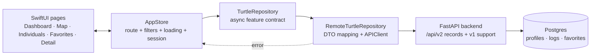

# Ada Penyu Desktop architecture

The desktop app is a native SwiftUI client with one state owner and a replaceable data boundary. Live mode starts with session restoration or sign-in before private records load. Live failures remain visible and never switch repositories automatically.

The I3S workspace has two matching paths. Database search goes through `AppStore` and the remote repository to MiewID/XFeat endpoints. Saved-fingerprint comparison runs locally in `I3SCompareEngine` after the user supplies annotations for both displayed photos. Local distances do not alter the backend ranking. See [I3S reference verification](i3s-reference.md) for compatibility evidence and extraction limits.

## Runtime architecture



## Responsibilities

| Layer | Files | Responsibility |
| --- | --- | --- |
| Shell | `ContentView.swift`, `Components/AppShellComponents.swift`, `Components/AdaFloatingPopup.swift` | Collapsible FigCraft sidebar, custom non-native floating popups, `⌘,` settings routing, contextual export, full-window Practice Review, and global error/loading surfaces. |
| State | `AppStore.swift`, `LocalizationManager.swift`, `DesktopContourPreferences.swift` | Owns route, query state, selected turtle, async loading, favorites, live EN/ID locale, per-account contour defaults, session generation, and export commands. |
| Contract | `DataLayer.swift` | Shared query/value types, `TurtleRepository`, API DTOs, date/status mapping, `RemoteTurtleRepository`, and `DemoTurtleRepository` (Bali, Asia, and Global datasets). |
| Spatial & Map | `H3/`, `H3SpatialIndex.swift`, `FrontendCountryResolver.swift`, `MapCanvasView.swift` | Vendored Uber H3 v4.5.0 C library for zoom-adaptive hexagonal aggregation (Res 1–6) transitioning to teardrop penyu markers, plus offline Natural Earth 50m GPS→Country resolution with a 370 km coastal EEZ buffer. |
| Settings | `Views/SettingsView.swift`, `PasswordSecuritySettings.swift`, `OrganisationSettingsModel.swift`, `OrganizationAPIKeySettings.swift` | iOS-parity adaptive Settings split workspace: Password & Security, Organisation Profile, owner-only Manage Rangers, Language (EN/ID), macOS App Permissions, per-account Contour Review defaults, and Organization API Key management. |
| Feature views | `Views/DashboardView.swift`, `CollectionViews.swift`, `TurtleDetailView.swift`, `Views/NotSureWorkspaceView.swift`, `Views/ScientistReviewWorkspaceView.swift`, `Views/PatternContourStudioView.swift` | Render records, interactive photo contour comparison (1-vs-3, 1:1, overlay), and review workflows. No view performs HTTP. |
| Domain/design | `AppModel.swift`, `DesignSystem.swift`, `Components/` | Stable display models, colors, spacing, condition semantics, branding, and reusable controls. |
| Backend | `app/api/`, `app/services/` | REST endpoints and persistence. |

## User flow

```text
Launch
  → AppStore.bootstrap()
  → restore remembered session or show sign-in
  → load real account + organization context
  → parallel individuals + favorites + dashboard + map requests
  → dashboard is immediately usable

Individuals
  → search/species/condition/sort
  → repository query with pagination
  → select row
  → detail loads measurements, locations, and sighting log

Map
  → period/species/condition filters
  → focus a pin or result card
  → explicit “Open turtle detail” action

Any API failure in Live mode
  → remain in Live mode
  → display the error and Retry

Logout / backend change
  → invalidate in-flight operations
  → clear private records, photos, details, and workspace state
  → return to sign-in
```

## API contract used by the desktop client

| Capability | Endpoint |
| --- | --- |
| Individuals | `GET /api/v2/individuals` |
| Favorites | `GET/PUT/DELETE /api/v1/favorites` |
| Dashboard | `GET /api/v1/dashboard/summary` |
| Map sightings | `GET /api/v1/dashboard/map/sightings` |
| Turtle detail | `GET /api/v2/individuals/{id}/logs` |
| Export | `GET /api/v1/exports/individuals` |

`Networking/` contains backend configuration, the session coordinator, Keychain refresh storage, HTTP transport, and v2 record DTOs. Protected requests have a bounded retry and reject responses from an older session. Bearer credentials only go to the configured origin; external image URLs receive no credentials and cross-origin redirects are rejected. All requests are made through `APIClient`, which centralizes ISO-8601 decoding and HTTP error handling. `RemoteTurtleRepository` translates backend DTOs into the view-facing models, so page code stays independent of response shape.

## Why this shape

- A single store prevents favorites, counts, search, and detail navigation from drifting between screens.
- Private bootstrap waits for a valid session; its four data requests then run concurrently.
- Empty, loading, and error states are explicit, so a slow or sparse backend never renders a misleading blank panel.
- Map filters are scoped to the map and no longer leak the Individuals page's filters.
