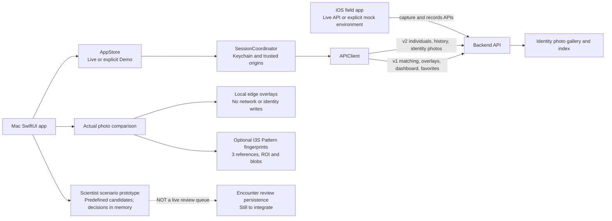
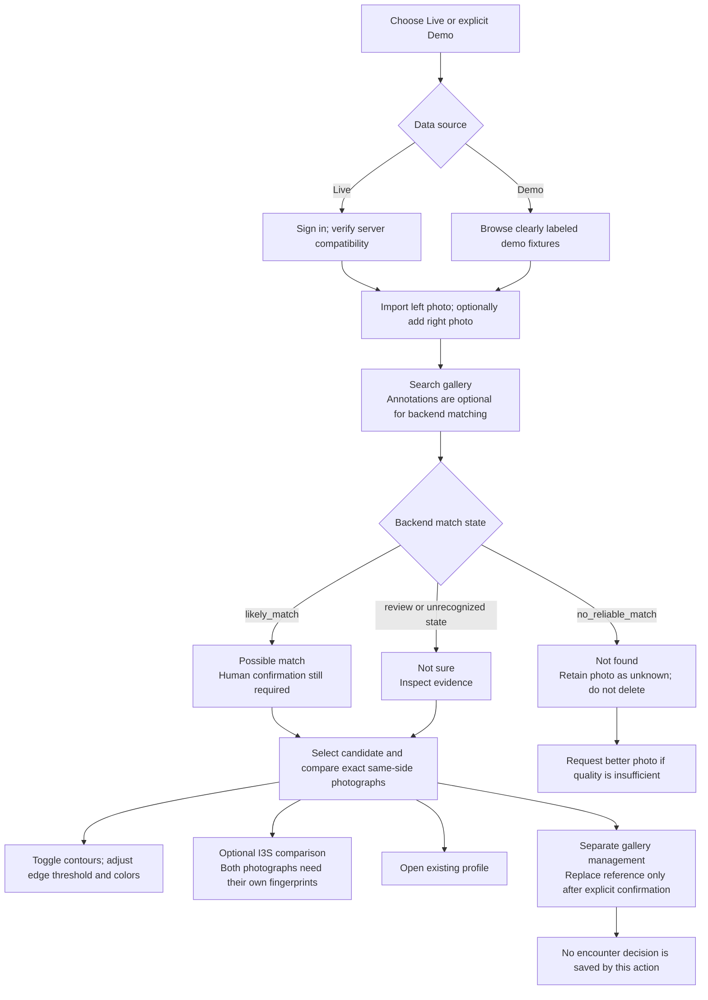
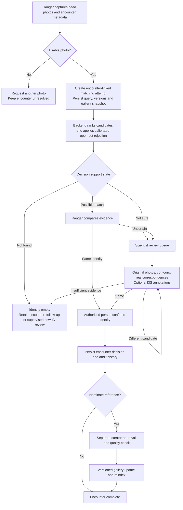
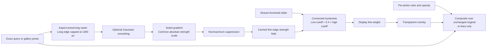

# Ada Penyu Mac — beta readiness audit, 13 November 2026

## Verdict and scope

The Mac application can support a supervised beta for browsing and visual comparison. It is not yet an end-to-end scientist encounter-review product. This audit starts from main `3aa7133` (PR #7), with Mac-only fixes on `fix/contour-review-20261113`. iOS and backend code were inspected without changes. No production data was uploaded or changed.

The previous local edits were preserved before the fast-forward pull in stash `ef6e2c218736f2ca49d3af6d81391c98e8828538`. They were not restored over PR #7. This is why the previous local contour work was absent from merged main. This dated audit supersedes earlier findings about authentication and record UUIDs that PR #7 already addressed.

## The system that exists

Solid links describe implemented responsibilities, not proof of deployment. The checked hosted OpenAPI exposed 34 v1 paths and zero v2 paths. The Mac expects v2 record endpoints; this deployment mismatch blocks a live release until authenticated smoke checks succeed. Public OpenAPI alone cannot prove authenticated availability or actual model/index versions.

iOS has separate mock `MatchingService` and live `MatchAPIService` wiring in `Services/AppEnvironment.swift`. Its existence does not prove which build users are running. The backend schema in `app/schemas/match.py` defines `match_state`, top-level `gallery_size`, and paired `merge_rank_score`; the Mac decoder had drifted from those fields.

## Findings and disposition

| Priority | Finding on pulled main | Disposition in this branch | Remaining evidence |
|---|---|---|---|
| P1 | No contour engine or visible contour control in I3S or scientist comparison | Shared local detector and actual-photo view; direct entry points, on/off, independent colors, common threshold, line weight, opacity and synchronized zoom/pan | Visual checks and deterministic raster tests |
| P1 | Match response keys differ from backend; paired same identity can crash a unique-key dictionary | Correct keys and safe side-specific lookup | Single empty response and duplicate-identity paired regressions |
| P1 | Missing gallery photo can silently become arbitrary Amina/Zizo photograph; failed XFeat request can become fake threads | Remove arbitrary photo and synthetic live-thread fallbacks | Missing image remains unavailable; demo/example evidence labeled |
| P1 | Bundled examples fabricate confidence, fused score and XFeat counts | Examples carry explicit provenance; only actual local I3S distance/pair count may be shown | Examples cannot replace live references |
| P1 | Changed query can retain old candidates; one companion fingerprint can be borrowed by both sides | Clear query results on input/side changes, maintain per-photo companion files, require explicit fingerprint loading | Candidate and render revisions reject late work |
| P1 | “Include in Database” actually replaces an identity reference and uses primary side even when reviewing right image | Explicit reference replacement with confirmation and immutable photo/side/session snapshot | This is not encounter confirmation; do not label it as such |
| P1 | Slow map/list/dashboard results can overwrite newer filters | Request revisions plus captured filter/session guards | Delayed-response regressions; full suite |
| P1 | Scientist interface claims saved/linking behavior but stores only in-memory scenario outcomes | Persistent demo notice; simulated actions and schematic overlays labeled | Live encounter queue, authoritative decisions and durable history remain unimplemented |
| P1 | Hosted v2 deployment not established | Documented release gate; no backend changes in this scope | Backend owner must deploy compatible API and verify auth/records |
| P1 | Open-set adapter/OSNN/RANSAC serving state and calibrated rejection are not established by the UI | No new percentage acceptance rules; preserve backend state and require human review | Frozen compatible bundle and independent evaluation needed |
| P2 | Wide segmented controls obscure comparison at narrow widths | Compact native menus; horizontal reachability for auxiliary controls | Minimum-window manual checks |
| P2 | Signed distribution, real Keychain restore and operational recovery unverified | Kept separate from unsigned local verification | Signed beta smoke test and support/recovery procedure |

## Operator flow available now

A 90% backend score is not automatically a 90% probability of identity. `likely_match`, `review` and `no_reliable_match` remain the backend's state, shown with human-readable labels. This branch does not invent acceptance cutoffs or automatic enrollment.

## Recommended complete encounter workflow — still proposed

The Mac currently lacks the encounter-backed queue and decision persistence in this diagram. Its scientist scenarios are demonstrations. Resolving how the Mac selects/creates the parent encounter and attempt is required before integrating v2 matching. PR #7 explicitly deferred that contract.

## What contour and annotation mean

Contour is a local viewing aid. It does not identify a turtle, change embeddings, improve an index, prove scale anatomy, run RANSAC, or save an annotation. It detects image intensity boundaries, including glare and background. Each original and its overlay share the same aspect-fit rectangle, zoom and pan; the two photos are not geometrically registered to one another.

Color and opacity updates do not recompute detection. Threshold changes reuse the strength field. New photo/noise settings invalidate it; canceled workers do not publish old overlays. Debouncing reduces slider churn. No anatomical segmentation accuracy claim is made.

I3S Pattern annotation is a different optional tool: each compared image needs its own three reference points, facial ROI and blob/keypoint fingerprint. Existing gallery fingerprints can be reused when they belong to the exact photograph. It is assisted manual comparison, not a replacement for the MiewID embedding index. Loading a companion fingerprint requires an explicit action; left and right companions are separate. The 83-photo gallery does not need I3S annotations merely to perform backend embedding/XFeat retrieval.

## Research and design decisions

- The [OpenCV Canny tutorial](https://docs.opencv.org/4.x/da/d22/tutorial_py_canny.html) describes smoothing, Sobel gradients, thin-edge suppression and connected two-threshold selection. This branch implements those principles in Swift with a 3×3 smoothing kernel. It does not install or claim bit-for-bit parity with OpenCV.
- [Apple Vision contour detection](https://developer.apple.com/documentation/vision/vndetectcontoursrequest) was considered. Its [maximum image dimension](https://developer.apple.com/documentation/vision/vndetectcontoursrequest/maximumimagedimension) defaults to 512; downsampling and contrast behavior require care for small scale details. A controllable raster edge aid was chosen for this beta, not proven scientifically superior.
- [Apple HIG color guidance](https://developer.apple.com/design/human-interface-guidelines/color) supports consistent semantics and labels in addition to color. Existing AdaColors, cards, dividers and native controls are retained. Query/gallery labels remain visible independently of tint. A small high-contrast preset palette avoids obscuring the photos with an external color panel.
- [Archify](https://github.com/tt-a1i/archify) was researched but is not installed in this workspace. Per the user's allowance for Notion or another tool, these architecture/flow diagrams use Mermaid in Notion and in the repository. No Archify renderer or automated Archify layout validation is claimed.

## Release gates

1. Deploy a compatible v2 backend and smoke-test authenticated list, detail/history, identity photos, favorites, dashboard and match routes against the intended server. Confirm organizations and permissions with real test accounts.
2. Integrate parent encounter/attempt selection, durable unresolved review queue and authorized decisions. Keep gallery enrollment separate. Verify restarting the Mac retains the authoritative decision.
3. Prove the actual served model, adapter, OSNN calibration, rejection cutoff and gallery fingerprint as one compatible bundle. Evaluate independent encounters with DIR/FPIR, wrong-known assignments and review rate; do not use rank-1 alone.
4. Verify signed beta Keychain login/restore/logout/refresh, trusted image origins and connection recovery. Unsigned local tests are not distribution evidence.
5. Run user task sessions with ranger and scientist photos: glare, low contrast, right side, missing references, narrow windows and ambiguous candidates. Record failures before changing defaults.

## Validation record

Baseline main: full Xcode test suite succeeded before changes (`build/verification/baseline-main-3aa7133.log`). Added regressions first reproduced invalid match decoding and stale-map response/error bugs. Seven deterministic contour tests cover blank rasters, edge thinning, connected weak edges, threshold behavior, line dilation, malformed inputs and asymmetric photo/overlay orientation. Eleven targeted tests then passed.

Manual UI on the updated build verified visible query/gallery contours on bundled Amina photos, on/off entry point, edge threshold change from 0.08 to 0.15, and lines-only mode. Additional final suite, Release build and color/minimum-window observations are recorded below when completed. No production writes or model stress/load benchmark were performed.

### Final verification

- Full reviewed Debug suite: **55 tests, zero failures**, `build/verification/contour-beta-reviewed-full.log`; result bundle `build/beta-ready-qa/Logs/Test/Test-Ada_Penyu_Desktop-2026.11.13_16-05-23-+0800.xcresult`.
- Unsigned Release build: **BUILD SUCCEEDED**, `build/verification/contour-beta-release.log`.
- Fresh whole-change review: two Important issues (dual-side ownership and stale backend results after choosing examples), fixed with failing-then-passing negative regressions. The final suite includes all four input/source ownership tests. No deferred minors.
- Manual UI verified both I3S and Scientist Review contour paths, actual edge overlays on left/right bundled photographs, query color change from cyan to the Magenta palette option, threshold 0.08→0.15, lines-only, turning contours off, explicit scientist demo notice and blocked dual-mode switch for a Right primary photograph.
- Visual inspection used an isolated build with bundle ID `test.Ada-Penyu-Desktop.ContourQA` to avoid the user's simultaneous Xcode runs. Default-size display was inspected. Minimum-size drag attempts failed with computer-use `noWindowsAvailable`; **minimum-window behavior is not manually verified** and remains in the beta task checklist.
- Three focused commits separate backend/data correctness, comparison UI/engine, and documentation. User edits to the login preview and Xcode project remain unstaged and excluded.

### Where to find contour

I3S Pattern ID → import a photograph or choose a sample → Search in Database / Compare Visually with Sample Gallery → **Contours** in the comparison header. Use the Query/Gallery color menus and shared Edge threshold below it. The View menu also offers Photos & contours, Keypoints & XFeat, multi-candidate comparison and point cloud.

Scientist Review → **Photo contours**. This computes real image edges on the bundled scenario photos; candidate identities, percentages and decisions on that screen remain simulated.
