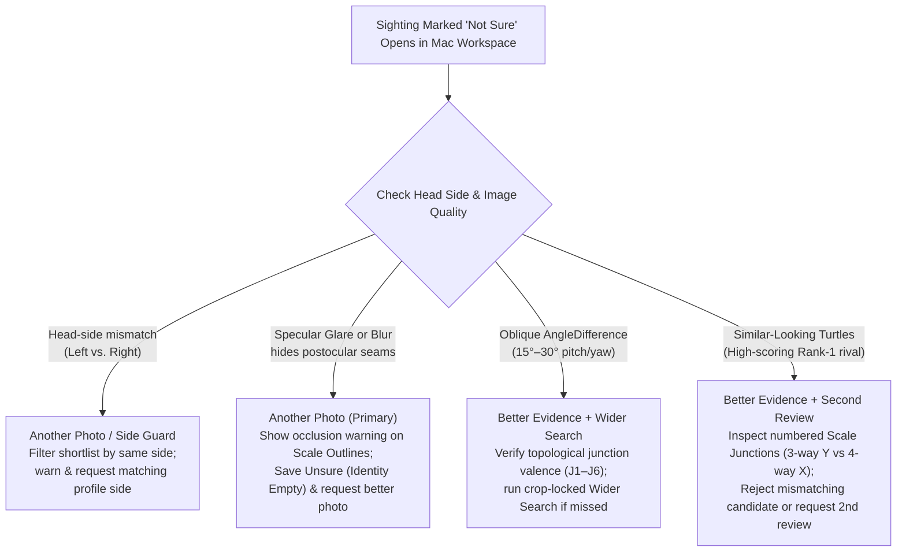

# ADA Penyu · Mac Scientist Review Workspace: Research Brief & Pilot Plan

> [!IMPORTANT]
> **Core Recommendation**
> Pairwise verification on Mac should start with **clean, synchronized side-by-side original photos** (`Sighting` left, `Gallery candidate` right) and offer a one-click **`Scale outlines & numbered junctions`** toggle (`J1`–`J6` behind the eye) as the primary comparison aid, alongside **`Head region outline` (crop)** and **`XFeat points`**. Keep **`I3S Pattern`** tucked under **`More evidence`** (`Lower means closer patterns`) as an optional tie-breaker rather than the default workflow, because manual 3-landmark + 35-blob annotation costs ~60–120 s per photo and its distances overlapped between genuine matches (`3.28–15.55`) and rivals (`11.16–22.35`) in ADA Penyu's 13-photo open-set replay.

---

## 1. Research Brief: How Scientists Verify Individual Sea Turtles

### Primary Studies & Real Conservation Workflows

| Study / Workflow | Species & Sample Size | What Was Measured & Quantitative Findings | Workflow Takeaway for ADA Penyu |
| :--- | :--- | :--- | :--- |
| **[Sea Turtle Photo-ID Practical Guide](https://georgehbalazs.com/wp-content/uploads/2025/03/Papafitsoros-Hoh-et-al.-2025-Sea-Turtle-Photo-Identification-A-Practical-Guide.pdf)** Papafitsoros, Hoh, Köhnk, Montagna, & Witzmann (2025), *IUCN/SSC MTSG Manual* | All 7 sea turtle species; primary focus on hard-shelled species (*Chelonia mydas*, *Eretmochelys imbricata*, *Caretta caretta*) | Synthesizes multi-decade photo-ID protocols (including the Zakynthos *Caretta caretta* program of **438 individuals / 8,729 photos** over 13 years; [Adam et al., WACV 2024](https://openaccess.thecvf.com/content/WACV2024/papers/Adam_SeaTurtleID2022_A_Long-Span_Dataset_for_Reliable_Sea_Turtle_Re-Identification_WACV_2024_paper.pdf)). | Postocular, central, and temporal facial scutes form lifelong polygonal mosaics. Left and right profiles are **biologically asymmetrical** and must be matched same-side. Algorithms generate shortlists; **human visual inspection of scale shapes and inter-scale junctions is mandatory** before linking. **Sighting linking** and **reference gallery admission** must remain separate decisions. |
| **[2025 Comparison of Visual Review, I3S, and NaturePatternMatch](https://researchonline.jcu.edu.au/84735/7/84735_1.pdf)** Sandoval & Barrios-Garrido (2025), *Journal of Sea Research* | **$n = 118$ photo-identifiable profiles** (predominantly green turtles, *Chelonia mydas*, plus *Eretmochelys imbricata* and *Caretta caretta*) captured & tagged in the Gulf of Venezuela (2000–2017) | Evaluated individual matching effectiveness against known tag/recapture ground truth: • **Visual inspection ("by human eye"):** **100%** accuracy (benchmark precision, but slow across large catalogs) • **I3S Pattern:** **90%** matching accuracy • **NaturePatternMatch (NPM):** **65%** matching accuracy (degraded under glare, low contrast, and variable lighting) | Expert visual comparison of scale geometry is the **100% precision ceiling** once a shortlist is presented. Automated SIFT/blob detectors (NPM 65%, I3S 90%) help narrow candidates but make errors when lighting or contrast shifts. |
| **[Wildbook Matching & Review Workflow](https://wildbook.docs.wildme.org/data/matching-process.html)** Wild Me / *Internet of Turtles* | Multi-species conservation platform (*Chelonia mydas*, *Eretmochelys imbricata*, *Caretta caretta*) | Production human-in-the-loop verification pipeline: head detection annotation $\rightarrow$ study-site & viewpoint filtering $\rightarrow$ ranked **Individual Scores** & **Image Scores** $\rightarrow$ side-by-side **Inspect** view. | Algorithms **never assign identity autonomously**. Reviewers inspect clean photos alongside toggleable feature correspondences, explicitly accounting for score directionality (similarity vs. distance), and confirm links to a *Marked Individual* or leave encounters unapproved. |
| **[HotSpotter Sea Turtle Study](https://scholarsrepository.llu.edu/fac_pubs/318/)** Dunbar, Anger, Parham, et al. (2021), *J. Exp. Mar. Biol. Ecol.* 535: 151490 | Hawksbill sea turtles (*Eretmochelys imbricata*); gallery of **2,136 photographs** queried with **$n = 158$ new photographs** in Roatán, Honduras | Measured shortlist retrieval recall across variable underwater/surface angles with minimal preprocessing: • **All queries ($n = 158$):** **80% Rank-1**, **91% Top-6** • **In-water subset:** **84% Rank-1**, **94% Top-6** | Dense local descriptor indexing with spatial RANSAC reranking achieves >90% Top-6 retrieval without manual landmarking, leaving pairwise human verification as the final step. |
| **[I3S Pattern Assessment on Captured vs. Free-Swimming Turtles](https://doi.org/10.3354/meps12483)** Calmanovici et al. (2018), *Mar. Ecol. Prog. Ser.* 589: 263–268 | **436 photographs of 189 individual** immature green (*Chelonia mydas*) and hawksbill (*Eretmochelys imbricata*) turtles | Measured top-shortlist retrieval accuracy and review time: • **Captured turtles (perpendicular angle):** **97%** • **Free-swimming turtles (variable angle):** **85%** • Reduced catalog scan time by **80%**, but accuracy dropped sharply when head yaw/pitch exceeded **$> 30^\circ$**. | 3-point 2D affine alignment in I3S breaks down under $> 30^\circ$ 3D head rotation because facial scales sit on a curved cranium. |
| **[TORSOOI Scale Coding & Junction Topology](https://doi.org/10.1007/s00227-009-1387-7)** Jean, Ciccione, Talma, Ballorain, & Bourjea (2010), *Marine Biology* 157: 1061–1070 | **257 photographs of 75 individuals** (*Chelonia mydas* and *Eretmochelys imbricata*) at Réunion Island | Validated coding each postocular/temporal scale by row position and **polygon side count (3- to 8-sided scutes and 3-way vs. 4-way junctions)**. | Scale **polygon valence (number of sides) and vertex topology (3-scale Y-junction vs. 4-scale X-junction)** are invariant to moderate camera tilt. |
| **[Ontogenetic Scale Stability Validation](https://doi.org/10.1016/j.jembe.2015.12.003)** Carpentier et al. (2016), *J. Exp. Mar. Biol. Ecol.* 476: 15–21 | **90 captive green turtle (*Chelonia mydas*) hatchlings** photographed repeatedly (~1,800 images) over 1 year of rapid growth | Measured stability of facial scale patterns across growth and viewing angles: **100% topological stability** of scute boundaries and junctions; oblique angles **$> 20^\circ$** distort apparent 2D scale area/aspect ratio. | Scientists should verify **topological junctions and scale side-counts** rather than raw 2D Euclidean distances between scale centers. |
| **ADA Penyu Saved-Fingerprint Replay** [`i3s-v402-reference.json`](file:///Users/gung/Documents/SWIFT/ADA_Penyu_Desktop/Ada_Penyu_Desktop/Ada_Penyu_DesktopTests/Fixtures/i3s-v402-reference.json) | **13 pre-annotated `.fgp` photos from 5 green turtles (*Chelonia mydas*: Amina, Aikane, Ghost, Hoku, Zizo)**; **97 same-side pairs** verified against original C++ I3S v4.02 (`1e-6` parity) | • **Closed-set leave-one-encounter-out:** **13/13 (100%)** Rank-1 when true individual is present; genuine non-self distances span **`3.28–15.55`** (best genuine per query **`3.28–13.80`**). • **Open-set (true turtle removed):** Nearest rival distances span **`11.16–22.35`** (e.g., `Hoku2_L → Amina1_L = 11.16`, `Amina1_L → Hoku2_L = 11.77`), directly overlapping genuine distances (`Amina1_L → Amina2_L = 12.11`, `Amina2_L → Amina3_L = 12.68`). | An I3S distance around `11–14` **cannot distinguish a true match from a close rival**. Moreover, ADA Penyu's local Swift blob detector only approximates OpenCV 2.4.2 upright SURF. |

---

### Comparison of Pairwise Verification Methods (When Already Looking at Two Photos)

| Method | What It Adds Over Looking at Two Raw Photos | Annotation Effort Required | Where It Breaks Down |
| :--- | :--- | :--- | :--- |
| **1. Visual Scale Inspection (Clean Side-by-Side + Synced Zoom/Pan)** | Preserves unoccluded detail of inter-scale grooves (sulci), pigment margins, scars, and lighting artifacts. Represents the **100% precision ceiling** for trained experts ([Sandoval & Barrios-Garrido 2025](https://researchonline.jcu.edu.au/84735/7/84735_1.pdf)). | **0 s** (Zero annotation). | High visual working-memory load when comparing 10–20 polygonal scales across different head pitches or camera distances; easy to lose track of homologous vertices or fall for confirmation bias on a high-scoring Rank-1 lookalike. |
| **2. Scale Outlines & Numbered Junctions (`Recommended Primary Aid`)** | Directly externalizes the topological test scientists perform mentally ([Jean et al. 2010](https://doi.org/10.1007/s00227-009-1387-7); [Carpentier et al. 2016](https://doi.org/10.1016/j.jembe.2015.12.003)): traces postocular scale borders behind the eye and numbers homologous junctions (`J1`–`J6`). Immediately exposes when a single vertex differs (e.g., a **4-way X-junction** on the sighting vs. **two split 3-way Y-junctions** on a lookalike) even under $15^\circ\text{–}25^\circ$ angle tilt. | **0 s per review** if pre-traced on gallery references and auto-suggested; **~10–20 s** if the scientist taps 4–6 junctions on an ambiguous query. | Breaks down when specular sun glare, motion blur, or deep shadow physically obliterates the inter-scale grooves behind the eye—in which case the overlay must highlight the **occluded zone** rather than hallucinate edges. |
| **3. XFeat Correspondences (Automated Local Points)** | Explains *why* the backend ranked a candidate highly and provides zero-effort spatial anchor points across the two images. | **0 s** (Computed automatically by backend `XFeatMatcher` + LighterGlue). | Fires on high-contrast textures—including **water glare edges, beak rims, eye orbits, and neck folds**—rather than specifically on scale junctions. Without RANSAC geometric filtering, cross-linked lines clutter the exact scale seams the scientist needs to inspect. |
| **4. I3S Pattern v4.02 (3 Landmarks + ROI + 35 Blobs)** | Computes a repeatable 2D affine alignment from 3 landmarks (`beak tip`, `nasal eye corner`, `outer scale`) and a metric distance (`Lower means closer patterns`) across up to 35 scale centers. Useful as a secondary tie-breaker or for legacy `.fgp` catalogs. | **60–120 s per unannotated photo** (placing 3 landmarks, closing an 8–12 vertex polygon ROI, and manually pruning glare blobs / adding missed scales on both photos). | 1. **Open-set overlap:** Genuine distances (`3.28–15.55`) overlap rival distances (`11.16–22.35`) in ADA Penyu's 13-photo replay. 2. **3D rotation $> 30^\circ$:** 2D affine warping cannot correct out-of-plane curvature ([Calmanovici et al. 2018](https://doi.org/10.3354/meps12483)). 3. **Extractor gap:** Local Swift blob detection is an approximation of OpenCV 2.4.2 upright SURF. |

---

### Retrieval vs. Pairwise Verification: Evaluating HotSpotter & Wider Search

Retrieval performance (**Stage A: Does the true individual appear in the Top-$K$ shortlist?**) must be kept strictly separate from pairwise verification (**Stage B: Can the scientist tell whether the displayed pair is the same turtle?**):

1. **Why a true turtle misses the MiewID shortlist (Stage A failure):**
   - In [Adam et al. (WACV 2024, SeaTurtleID2022, $n = 8,729$ photos of $438$ *Caretta caretta*)](https://openaccess.thecvf.com/content/WACV2024/papers/Adam_SeaTurtleID2022_A_Long-Span_Dataset_for_Reliable_Sea_Turtle_Re-Identification_WACV_2024_paper.pdf), global embeddings degrade sharply when full-body or wide background water crops are fed into the backbone instead of tight head crops, or across multi-year lighting/angle shifts.
   - In ADA Penyu's current backend, `XFeatMatcher.match_count_lighterglue` counts raw correspondences without spatial **RANSAC inlier filtering**, allowing background/glare textures to inflate rival ranks.
2. **What HotSpotter / Local-Descriptor Indexing Adds to Retrieval:**
   - In [Dunbar et al. (2021)](https://scholarsrepository.llu.edu/fac_pubs/318/) across **2,136 *Eretmochelys imbricata* photos ($n = 158$ queries)**, HotSpotter (SIFT descriptors + Local Naive Bayes Nearest Neighbor one-vs-many scoring + spatial RANSAC reranking) achieved **80% Rank-1 / 91% Top-6** overall and **84% Rank-1 / 94% Top-6** on in-water photos.
   - **Recommendation:** Do not replace MiewID blindly. First, expose the **`Head region outline` (crop)** in the workspace and let the scientist trigger a **Wider search (Crop-locked re-index + RANSAC-filtered XFeat rerank over Top-15)**. If offline benchmarks on held-out encounters show MiewID + head-cropped XFeat Recall@5 is still **$< 90\%$**, integrate a **HotSpotter / LNBNN dense local-descriptor index** into Stage A's `Wider search`—while keeping Stage B's scientist UI clean and centered on scale-junction verification.

---

### Failure Modes & Workspace Action Matrix

| Condition | Primary Cause of Error | Recommended Workspace Response | Why This Response Wins |
| :--- | :--- | :--- | :--- |
| **Glare** (Specular water/sun reflection) | Washes out inter-scale sulci into white saturation; causes XFeat and I3S blob extractors to latch onto reflection edges. | **Another photo** (Save `Unsure` $\rightarrow$ *Request better photo*) + **Better evidence** (flag occluded junctions `J2–J4` rather than guessing lines). | Neither a wider database search nor manual I3S annotation can recover pixel information destroyed by specular saturation. |
| **Blur** (Motion blur / misfocus) | Erodes fine scale boundaries and suppresses local keypoints. | **Another photo** (Save `Unsure` $\rightarrow$ *Request better photo*; block gallery reference admission per [Papafitsoros et al. 2025](https://georgehbalazs.com/wp-content/uploads/2025/03/Papafitsoros-Hoh-et-al.-2025-Sea-Turtle-Photo-Identification-A-Practical-Guide.pdf)). | Enrolling or linking blurry photos pollutes future retrieval and mark-recapture survival estimates. |
| **Angle differences** ($15^\circ\text{–}30^\circ+$ yaw/pitch) | Foreshortens 2D scale aspect ratios; breaks 3-point 2D affine alignment above $30^\circ$ ([Calmanovici et al. 2018](https://doi.org/10.3354/meps12483)). | **Better evidence** (`Scale outlines & numbered junctions`) + **Wider search** (crop-adjusted retrieval). | Polygon side-count (e.g., 5-sided vs. 6-sided scute) and vertex valence (3-way vs. 4-way junction) are **topologically invariant** to perspective tilt ([Jean et al. 2010](https://doi.org/10.1007/s00227-009-1387-7); [Carpentier et al. 2016](https://doi.org/10.1016/j.jembe.2015.12.003)). |
| **Head-side mismatches** (Left vs. Right) | Left and right facial scute mosaics on the same individual are biologically asymmetrical ([Papafitsoros et al. 2025](https://georgehbalazs.com/wp-content/uploads/2025/03/Papafitsoros-Hoh-et-al.-2025-Sea-Turtle-Photo-Identification-A-Practical-Guide.pdf)). | **Another photo** + **Strict side guard** (prominent `LEFT` / `RIGHT` badges, default same-side filtering, explicit warning if a candidate only has an opposite-side photo). | Prevents invalid cross-side comparisons and prompts the ranger for the missing profile side. |
| **Similar-looking turtles** (Convincing Rank-1 rival) | Shared head shape, coloration, and 2–3 outer scales produce high relative MiewID scores (`80%+`) and overlapping I3S distances (`11.16–13.98`). | **Better evidence** (`Scale outlines & numbered junctions` to spot a single topological split like `J3`) + **Second review** (if partial scarring leaves two candidates plausible). | One verified topological junction mismatch rules out a lookalike immediately (`Different turtle` $\rightarrow$ advance to Rank #2). |

---

## 2. Clickable Prototype Architecture (`1440 × 900`)

We built the clickable prototype in **two forms** so it can be tested immediately in the Antigravity side pane, in any browser, or natively in Xcode:
1. **Interactive HTML Prototype Artifact:** [`ada_penyu_scientist_review_prototype.html`](file:///Users/gung/.gemini/antigravity/brain/6364666e-38be-4129-b658-389f336c2361/ada_penyu_scientist_review_prototype.html) (also saved in workspace at [`docs/scientist-review-prototype.html`](file:///Users/gung/Documents/SWIFT/ADA_Penyu_Desktop/docs/scientist-review-prototype.html))
2. **Native macOS SwiftUI View & ViewModel:** [`ScientistReviewWorkspaceView.swift`](file:///Users/gung/Documents/SWIFT/ADA_Penyu_Desktop/Ada_Penyu_Desktop/Ada_Penyu_Desktop/Views/ScientistReviewWorkspaceView.swift) integrated into [`ContentView.swift`](file:///Users/gung/Documents/SWIFT/ADA_Penyu_Desktop/Ada_Penyu_Desktop/Ada_Penyu_Desktop/ContentView.swift) and tested in [`ScientistReviewTests.swift`](file:///Users/gung/Documents/SWIFT/ADA_Penyu_Desktop/Ada_Penyu_Desktop/Ada_Penyu_DesktopTests/ScientistReviewTests.swift).

### Key Interactive Flows Implemented
- **Layout (`1440 × 900`):** Sighting photo pinned on the left, exact gallery photo on the right, and ranked candidate shortlist in a slim right inspector (`316–320 px`). Both photos display prominent **Side** (`LEFT PROFILE` / `RIGHT PROFILE`) and **Date** badges and support **synchronized zoom (`100%–320%`) and drag-to-pan**.
- **Starting View & Comparison Aids:** Opens on **clean original photos**. Scientists can toggle:
  - **`Scale outlines & junctions`** (traces visible postocular scale boundaries behind the eye and numbers corresponding junctions `1`–`6`),
  - **`Head region outline`** (shows the MiewID/XFeat head crop bounding box),
  - **`XFeat points`** (shows automated local correspondence points).
- **Evidence Drawer:** Shows the backend's **`Relative match score`** (explaining its relative-to-rival formula), scale-junction verification summary, and XFeat match count. Expanding **`More evidence`** reveals **`I3S Pattern`** with its distance explicitly labeled **`Lower means closer patterns`** (`11.77` vs. `12.11` from the ADA Penyu fixture) and a toggle for the 3-landmark/blob overlay.
- **Decision Actions (`Same turtle`, `Different turtle`, `Unsure`) & Two Scenarios:**
  - **Scenario 1 (Rank-1 Lookalike $\rightarrow$ Confirm Rank #2):** Rank #1 (`Turtle #019 · Surya`, `84%` relative score, `11.77` I3S distance) looks convincing at first glance, but toggling **`Scale outlines`** reveals that central postocular junction **`J3` splits into two 3-way Y-junctions** (6-sided `C1` scale) instead of the sighting's **4-way X-junction** (5-sided `C1` scale). Clicking **`Different turtle`** rejects Rank #1 and advances to Rank #2 (`Turtle #007 · Amina`, `79%` relative score, `12.11` I3S distance), where all 6 junctions (`J1`–`J6`) match. Clicking **`Same turtle`** asks the scientist to confirm `Turtle #007 · Amina` before linking while keeping gallery reference enrollment separate.
  - **Scenario 2 (Specular Glare Occlusion $\rightarrow$ Save Unsure):** Surface glare behind the right eye hides central junctions `J2`–`J4` (leaving only dorsal `J1` and ventral `J5` visible), making Rank #1 (`#023 Zizo`) and Rank #2 (`#031 Tirta`) indistinguishable, while Rank #3 (`#007 Amina`) triggers a **Head-side mismatch (`Left Only`)** warning. Clicking **`Unsure`** saves the sighting and notes with **Identity: Empty** and lets the scientist request a **better photo** or **second review**.
  - **Reset Demo:** Restores initial scenarios, overlays, zoom/pan, and candidate states with one click.

---

## 3. Scientist Pilot Plan & Build Prioritization

### Pilot Protocol (Within-Subject Counterbalanced Evaluation)

1. **Participants & Dataset ($N = 40$ Sightings, Fixed Shortlists):**
   - **Reviewers:** $4\text{–}6$ sea turtle researchers reviewing sightings on Mac (`1440 × 900`).
   - **Sighting Pool ($N = 40$ queries with frozen MiewID + XFeat Top-5 candidate lists):**
     - **24 Gallery-Present Sightings (`Closed-Set`):** 12 where the true individual is Rank #1, and 12 where the true individual is at Rank #2–#5 behind a high-scoring lookalike rival.
     - **16 Gallery-Absent Sightings (`Open-Set`):** 10 clear photos of uncataloged individuals (testing false-link resistance when the true turtle is absent from the gallery) and 6 quality-degraded photos (glare over postocular scales, motion blur, or $> 30^\circ$ head angle where `Unsure` is the correct outcome).

2. **Three Experimental Conditions (Latin-Square Counterbalanced Across Reviewers):**
   - **Condition 1 — Photos Alone (Baseline):** Clean side-by-side sighting and gallery photos with synchronized zoom/pan, side/date badges, and the backend `Relative match score` drawer.
   - **Condition 2 — Photos + Recommended Overlays (`Scale outlines & numbered junctions` + `Head region outline` + `XFeat points`):** Adds toggleable postocular scale outlines and numbered junctions (`J1`–`J6`).
   - **Condition 3 — Escalation to Optional I3S Pattern (`More evidence`) for Unresolved Pairs:** Reviewers start in Condition 2 and, for pairs that remain unresolved, run/annotate local I3S Pattern v4.02 comparison (`Lower means closer patterns`).

3. **Metrics to Measure:**
   - **Correct confirmations (True Positive link rate on `Present` sightings):** Proportion of gallery-present sightings linked to the correct individual (tracked separately for Rank-1 vs. Rank 2–5 true matches).
   - **Wrong links (False Positive misidentification rate):**
     - *Lookalike rank errors* (linking a `Present` sighting to the wrong candidate in the shortlist).
     - *Open-set false acceptances* (linking an `Absent` unknown turtle or glare-occluded photo to an existing gallery turtle; **target $< 2\%$**).
   - **Deferred cases (`Unsure` rate & appropriateness):** Proportion of glare/blur/ambiguous cases appropriately deferred as `Unsure` vs. clear matches unnecessarily deferred.
   - **Total review time per sighting (seconds, including annotation):** Full wall-clock duration from sighting load to final decision (`Same turtle`, `Different turtle`, or `Unsure`), logging any time spent marking junctions or placing I3S landmarks, ROI vertices, and keypoints.

---

### What to Build First & What Result Would Justify a More Complex Method

1. **What We Would Build First (Phase 1 Production Slice):**
   - Build the **synchronized side-by-side review workspace starting with clean original photos**, the **3-decision bar (`Same turtle` with confirmation, `Different turtle` with auto-advance, `Unsure` with empty identity + follow-up requests)**, same-side profile guards, and the **`Scale outlines & numbered junctions` overlay** (pre-traced once per gallery reference photo when a reference is admitted to the catalog, paired with `Head region outline` and `XFeat points`).
   - **Why first:** It directly targets the topological features (polygon side counts and 3-way vs. 4-way junctions) that give human reviewers 100% precision ([Jean et al. 2010](https://doi.org/10.1007/s00227-009-1387-7); [Sandoval & Barrios-Garrido 2025](https://researchonline.jcu.edu.au/84735/7/84735_1.pdf)) while adding **0 seconds of annotation time** during routine sighting review.

2. **What Pilot Result Would Justify Adding a More Complex Comparison Method (Phase 2 Gates):**
   - **Gate A — Justifying Interactive I3S Pattern Annotation in the Review Loop:** Only invest in full interactive I3S annotation (and porting exact OpenCV 2.4.2 upright SURF extraction to replace the Swift blob approximation) if **Condition 3 converts $\ge 15\%$ of pairs left `Unsure` in Condition 2 into correct confirmations with $0$ additional wrong links**, while keeping median total review + annotation time **$\le 90\text{ s}$ per escalated sighting**. If Condition 2 (`Scale outlines & junctions`) already achieves $\ge 95\%$ correct confirmations on clear `Present` sightings and $< 2\%$ wrong links on `Absent` sightings—or if I3S's open-set distance overlap (`11.16–15.55`) induces false confidence on rivals—keep I3S strictly as a read-only legacy `.fgp` viewer under `More evidence`.
   - **Gate B — Justifying Semi-Automated Topological Graph Matching:** If scientists in Condition 2 still spend $> 45\text{ s}$ mentally matching junctions on oblique ($20^\circ\text{–}30^\circ$) sightings, add a lightweight **one-click scale-segmentation / junction-graph matcher** (extracting the planar dual graph of postocular scute polygons from SAM/contour segmentation) rather than blob-centroid matching.
   - **Gate C — Justifying HotSpotter / Dense Local Indexing in Backend Retrieval:** If held-out retrieval benchmarks show MiewID + head-cropped XFeat misses the true turtle from the Top-5 shortlist on **$> 10\%$ of clear known encounters (Recall@5 $< 90\%$)**, add a **HotSpotter-style LNBNN + spatial RANSAC local descriptor index** ([Dunbar et al. 2021](https://scholarsrepository.llu.edu/fac_pubs/318/)) behind the workspace's **`Run wider search`** action.
